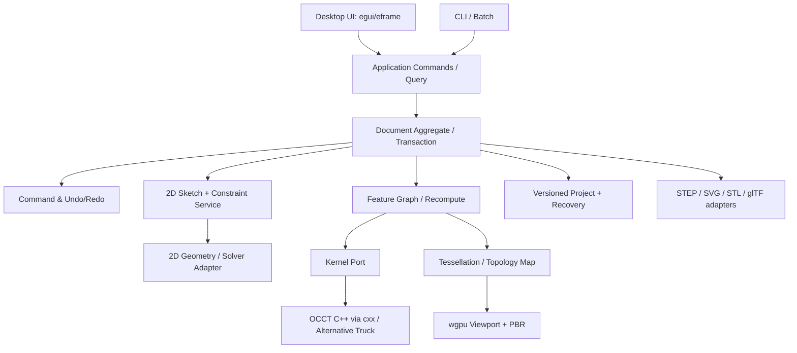

# 전체 시스템 디자인과 실행 경계

> 문서상태: **기획 확정 전 · 구현 검증 필요**  
> 문서버전: v2.1-draft (2026-10-25)  
> 문서목적: 전체 시스템 디자인과 실행 경계
> 원문 추적: 2

---

## 1. 아키텍처 원칙

기존 `cad_core`, `cad_geometry`, `cad_tolerance`, `cad_command`, `cad_render`, `cad_io`, `cad_batch`, `cad_cli`, `cad_app`를 버리지 않고, **설계 문서/2D 스케치/3D 피처/B-Rep 커널/테셀레이션/GPU/파일 어댑터**를 명시적으로 추가합니다. Rust는 애플리케이션과 도메인 오케스트레이션을 담당하고 검증된 C++ 커널의 정밀 연산은 외부 boundary에 격리합니다.



## 2. 제안 Cargo workspace

```text
cad_studio/
├── Cargo.toml                     # lockfile 커밋, version pin, feature flags
├── apps/
│   ├── cad_app/                   # Desktop shell / UI states / keymap
│   └── cad_cli/                   # validate / inspect / export / recover
├── crates/
│   ├── cad_types/                 # IDs, Length/Angle, coordinate primitives, Error
│   ├── cad_core/                  # Document, Entity, Layer, Body, Sketch, Feature refs
│   ├── cad_geometry/              # 2D/3D analytic geometry, predicates, transforms
│   ├── cad_sketch/                # Sketch constraints + solver port
│   ├── cad_tolerance/             # Dimension, tolerance, trace, standards policy
│   ├── cad_command/               # Transaction, undo/redo, dirty set
│   ├── cad_feature/               # Feature DAG, regeneration, referential repair
│   ├── cad_kernel_api/            # KernelPort trait/types and result codes
│   ├── cad_kernel_occt/           # Dedicated C++ build/FFI wrapper **unsafe boundary**
│   ├── cad_tessellation/          # BRep to triangle mesh, face/edge IDs, cache
│   ├── cad_render/                # RenderScene/RenderPrimitives independent of GPU
│   ├── cad_viewport_wgpu/         # GPU pipelines, camera, picking, PBR
│   ├── cad_io/                    # Native archive, migrations, autosave, backups
│   ├── cad_exchange/              # Format ports: STEP/STL/glTF/DXF/SVG/PDF
│   ├── cad_batch/                 # job runner, deterministic reporting
│   └── cad_testing/               # Fixture helpers/shape checks
├── native/occt_bridge/            # C++ façade, CMake config; tests
├── schemas/                       # JSON schemas + fixture files
├── tests/e2e/                      # Goldens, crash/integration scenarios
└── docs/
```

> 모든 crate를 Phase 0에 빈 형태로 한 번에 생성할 필요는 없습니다. **경계와 인터페이스를 먼저 확정한 뒤 단계별 추가**합니다. 의존성 사이클은 금지합니다.

## 3. 각 계층의 책임

| 계층 | 책임 | 책임이 아닌 것 |
|---|---|---|
| cad_core | 도메인 aggregate, 안정 ID, 참조 제약 | OCCT TShape/GUI 포인터 보유 |
| cad_command | 불변조건 사전검증, 트랜잭션, inverse/snapshot Undo | 직접 GPU buffer 갱신 |
| cad_geometry | Rust 자체 기하 알고리즘, snap/hit-test, 단위·수치 정책 | 본격 솔리드 Boolean을 처음부터 독자 구현 |
| cad_sketch | plane-local entities, DOF, solver status, constraint graph | 3D mesh를 정밀 스케치로 취급 |
| cad_feature | DAG, dirty propagation, regen staging, topology refs | 렌더링 FPS 관리 |
| cad_kernel_api | `ShapeHandle` 추상화, 실패 코드, 독립 mock | C++ 헤더 누출 |
| cad_kernel_occt | 커널 연산 및 리소스·예외·스레드 제한 캡슐화 | Document·UI 상태 소유 |
| cad_tessellation | B-Rep faceting + face→triangle association | 설계 원본 데이터 관리 |
| cad_render | RenderScene과 layer/style/material 가시성 | 모델 영속화·편집 |
| cad_viewport_wgpu | draw/pick/camera/GPU resource | shape validity 검사 |
| cad_io | schema DTO, atomic save, autosave, migration | STEP 재수입을 native-load라고 간주 |
| cad_exchange | 포맷별 손실·단위·지원 매핑 | 내부 stable IDs를 외부 handle로 대체 |

## 6. 언어·런타임 정책

- Rust: UI, 도메인, command, sketch graph, persistence, CLI, renderer.
- C++(종속 코드/작은 façade): OCCT B-Rep kernel, Boolean, STEP, tessellation. **Rust만 사용한다는 이전 방향을 바꾸는 제안**이며 10번 ADR 게이트 필요.
- WGSL: GPU 셰이더.
- Python/웹 서버/클라우드: 초기 필수 아님. 필요한 경우 batch scripting을 CLI/API로 먼저 지원.
- `#![forbid(unsafe_code)]`는 안전한 pure-Rust crates에 유지, **`cad_kernel_occt`/GPU FFI의 예외를 격리·문서화**. workspace 전체 unsafe 전면 금지와 OCCT 연동은 동시에 충족될 수 없음.

## 아키텍처별 책임 체계

```text
[Desktop GUI egui/eframe]       [CLI / Batch]
             └────────┬────────────┘
                 Application API
                      │
             Command / Query + Document
               ┌──────┴─────────┐
        Sketch/Constraints    Feature DAG
               │                 │
        Geometry + Solver     KernelPort
                                 │
                           OCCT C++ (후보)
                                 │
                     B-Rep → Tessellation
                               ┌───┴────┐
                         wgpu Viewport   Exchange
                               │         │
                       Mesh Cache     STEP/STL

       cad_io: authoritative Native Project/Autosave/Migration
```

이 구조에서 FE는 **로컬 데스크톱 GUI**, BE는 **in-process Rust 도메인/계산 엔진**, DB는 **버전 저장 포맷과 영속 관리**, 인프라는 **로컬 빌드·배포·운영 및 선택적 외부 CAD 데이터 교환**입니다. 백엔드가 반드시 HTTP 서버나 DBMS를 뜻하지 않습니다.
